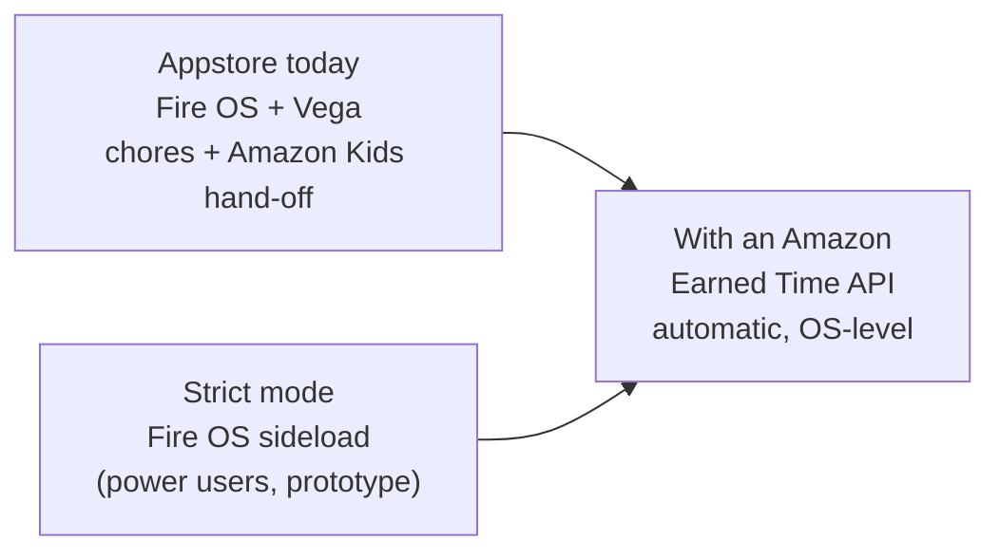

# 02 · Approaches and trade-offs

Legend: ✅ recommended · ◻️ alternative / later · ❌ not recommended.
Everything here was researched on 2026-10-02. Sources are at the bottom.
**Updated 2026-10-05:** the AI photo pre-check was dropped (parents approve on the phone or TV), and AI-written **brain games** were added (§7).

## 0. Short verdict

- **The idea is viable and fits the Fire TV track:** family entertainment and multi-modal UX (TV + phone + voice), plus AI-written learning games. *(Photo-checked chores, the computer-vision angle, were dropped on Oct 5.)*
- **Locking other apps** works on Fire OS (your 4K Plus) when sideloaded. It is **impossible on Vega**, and it **can't pass Appstore certification**. As the *whole* product it would score poorly on Potential Impact.
- **So the reframe:** the core product is the **chore and approval economy**, which needs no special permissions and runs on Fire OS *and* Vega. Enforcement comes in three modes:
  - **Amazon Kids** (Appstore, today)
  - **Strict** (Fire OS sideload, demo and power users)
  - **Earned Time API** (our proposal to Amazon)
- **Where we differ:** Amazon Kids already has limits, bedtime and (since Sept 24 2026) one-tap *bonus* time. **No one turns verified real-world chores into TV minutes, and Amazon has no API for it.** Pitch: *"Amazon gives bonus time. We make it earned."*

---

## 1. Product framing: what ships and what is a prototype

**Why the lock can't be the product:**

1. Amazon's **Device & System Abuse Policy** bans apps that alter the native UI, *"e.g., lockscreens, widgets, launchers, floating windows"*.
2. The **certification tests** require that HOME returns to the launcher and that an app *"must not force the user to exit"*.
3. **Fire OS has no settings screen** for the permissions a lock needs (usage access, display over other apps, third-party accessibility). Even outside the store, setup needs a computer and ADB, and normal parents won't do that.
4. **Vega offers none of these capabilities** to third-party apps, and Amazon says all future sticks will run Vega.

**The three modes:**

| | Amazon Kids mode ✅ | Strict mode ✅ (sideload) | Earned Time API ◻️ (proposal) |
|---|---|---|---|
| Runs on | Fire OS + Vega, Appstore | Fire OS only, sideloaded + ADB setup | Fire OS + Vega |
| Enforcement | Amazon Kids daily limit (OS-level) | TimeJar's usage watcher + lock screen | The OS, through the API |
| Minutes from chores | Parent adds **bonus time** in Amazon's Parent Dashboard. TimeJar hands it off: one tap that opens the dashboard. | Automatic | Automatic (`grantBonusTime`) |
| Kid locked out → can they still claim on the TV? | Probably not (the profile locks). Claim by **phone, voice, or before time runs out**. *(Per-category limits might keep TimeJar open: check on day 1.)* | Yes. The lock screen *is* the chore board. | Yes |
| Role in the hackathon | **The shippable product** | **The demo's magic moment**: shows what the API would enable | **The "Shape" ask**, written up in [07](07-earned-time-api.md) |

---

## 2. Platform and TV app stack

| Option | Fire OS | Vega | Strict mode | Effort and risk | Verdict |
|---|---|---|---|---|---|
| **A. React Native monorepo** (`react-native-multi-tv-helloworld`: shared package + Expo TV app + Vega app) + **Kotlin strict-mode module** in the Fire OS build | ✅ | ✅ | ✅ | Medium-high: RN TV toolchain, a 20 GB Vega SDK, native module bridge | ✅ |
| B. Native Kotlin + Compose for TV (`hello-world-fire-tv`) | ✅ | ❌ | ✅ | Medium, best agent loop | ◻️ **fallback** if Vega or RN fights us |
| C. Vega only (React Native for Vega) | ❌ | ✅ | ❌ | Medium | ❌ can't test on your stick |
| D. Web UI in two shells (WebView on Fire OS, RN WebView on Vega) | ✅ | ✅ | ✅ (Kotlin shell) | Medium, less native feel | ◻️ |

**Why A:**
- It is Amazon's own cross-platform starter (Yarn 4 workspaces).
- Platform-specific files use extensions (`.android.tsx`, `.kepler.tsx`), so the Fire OS-only strict-mode bridge lives in `.android` files and Vega gets a stub.
- Amazon's AI builder tools are Vega-first (focus management, navigation and UI skills), so they actually help here.
- **Risks:**
  - The helloworld's Expo build lists Android TV, not Fire OS, so it gets a smoke test on the stick on day 1.
  - The Vega SDK needs ≥ 20 GB of disk.
  - **Cut line:** if Vega isn't running by Oct 12, ship Fire OS only and keep the shared code "Vega-ready" (04).

**Devices:**
- Fire TV Stick 4K Plus = **Fire OS 8, Android 11 / API 30, 32-bit, 2 GB RAM**.
- Vega is tested on the **Vega Virtual Device** on the Mac. The rules accept the simulator.

---

## 3. Enforcement mechanisms in detail

| # | Mechanism | Strength | Appstore | Used in |
|---|---|---|---|---|
| **K1** | **Amazon Kids daily limit + parent-added bonus time** | Strong, OS-level | native | Amazon Kids mode ✅ |
| **S1** | **UsageStatsManager**: which app is in front and for how long (granted with `pm grant`) | Reliable, 1–2 s delay | allowed, but no UI to grant | Strict ✅ |
| **S2** | **AccessibilityService**: instant events plus a *watchdog* that keeps our service alive (enabled via ADB) | Instant, survives reboot | unclear | Strict, optional (see ⚠️) |
| **S3** | **Lock**: LockActivity brought to the front, with a full-screen `SYSTEM_ALERT_WINDOW` overlay as fallback | Strong. HOME can't be blocked, but we re-lock within ~1–2 s | ❌ | Strict ✅ |
| A1 | **Earned Time API** (proposed) | OS-level | — | Future ([07](07-earned-time-api.md)) |
| X1 | Soft mode: our app as the kid's portal (Home escapes it) | Weak | allowed | ❌ no longer needed: Amazon Kids mode is better |
| X2 | Network pause (NextDNS API; eero only has an unofficial API or Alexa skill) | Blunt | n/a | ◻️ future |
| X3 | Device owner / kiosk lock-task | — | — | ❌ impossible on consumer Fire TV |
| X4 | Custom launcher / catching HOME | Fragile | ❌ | ❌ Amazon blocks it |
| X5 | Smart plug / HDMI-CEC power-off | Blunt | — | ❌ |

⚠️ While any accessibility service is on, **Prime Video stops auto-hiding its playback controls**. The day-1 spike decides whether S2 is on by default.

**Strict mode: what a determined kid can do, and our answer:**

| Bypass | Answer |
|---|---|
| Home / reopen the app / *"Alexa, open YouTube"* | Detected → locked again within ~1–2 s |
| Settings → force-stop or uninstall (a force-stop also switches off our accessibility service) | **Heartbeat stops → the parent gets a "TV not reporting" alert.** Better still, use a **Fire TV kid profile**: Fire TV settings are blocked inside kid profiles. Optional "Protect Settings" PIN. |
| Pull the power plug | Restarts at boot. The short gap is measured in the spike. |

**Amazon Kids mode limitations (we're honest about them):**
- The hand-off is manual until the API exists.
- We can't *read* the remaining Amazon Kids time, so the TV shows *earned* minutes, not *remaining* minutes.
- Bonus time on a **Fire TV** kid profile still has to be confirmed (day 1).

---

## 4. Chore approval: how minutes are granted

You asked about *"mobile app or code on the chore?"*:

| # | Option | Proves the chore was done? | Verdict |
|---|---|---|---|
| **V1** | **Parent approves on the phone** (PWA, from anywhere) | Parent decides | ✅ core |
| **V2** | **Parent PIN on the TV** | Parent decides | ✅ (works offline) |
| V3 | **Scan the TV's QR → one-tap approve** on the phone | Parent decides | ✅ quick flow |
| V4 | **One-time "TV ticket" codes** generated on the phone. The kid types 6 digits on the TV; codes are HMAC/TOTP-style, checked offline, and work once. | Parent decides | ◻️ fun extra |
| V5 | **Static QR/NFC sticker on the chore** | ❌ only shows the kid was there | ◻️ only as a *claim shortcut* |
| V6 | AI photo pre-check (Bedrock vision): verdict + reason, but the parent still approves | Helps the parent decide | ❌ dropped Oct 5: parents approve on the phone or TV, no photos needed |
| V7 | **Voice claim** (*"Alexa, tell TimeJar I cleaned my room"*). In Amazon Kids mode it also works while the TV is locked. | Parent decides | ◻️ stretch #2 |
| V8 | Ring camera events | Partly | ❌ for the hackathon |

**Penalties** are a negative ledger entry with a reason.
- In **strict mode** they reduce the balance, which may go below zero ("debt").
- In **Amazon Kids mode** they are *netted* against the next hand-off: earned 30, penalty 10 → the next hand-off suggests +20.

---

## 5. Parent app

| Option | Verdict | Why |
|---|---|---|
| **PWA** (React + Vite, installable) | ✅ | Fastest. The camera works for QR. It hosts the Amazon Kids hand-off button (opens `parents.amazon.com`) and an optional **kid view** for claiming from a family tablet. |
| Native iOS/Android app | ❌ | Too slow for 3 weeks |
| Parent mode on the TV (PIN) | ✅ | Part of the MVP |
| Voice (Alexa skill / Alexa+ MCP) | ◻️ | §7 |

**Sign-in:** Cognito email + password. Optional **Login with Amazon** (a Cognito social IdP) fits the ecosystem.

---

## 6. Backend and real-time sync

| Option | Verdict | Notes |
|---|---|---|
| **B1. AWS CDK serverless REST** (API Gateway HTTP API + Lambda TS + DynamoDB + Cognito + S3) | ✅ | Predictable code, simple device-token auth for the TV, plain `fetch` (works on Fire OS **and Vega**). Qualifies for **AWS Builder**. |
| B2. Amplify Gen 2 | ◻️ | Fast for the PWA, but **Amplify JS doesn't run on Vega** (it needs native modules that weren't ported) |
| B3. LAN-only (the TV hosts the parent page itself) | ◻️ | No cloud, but no remote approvals, no notifications, no AWS Builder |
| B4. Firebase / Supabase | ◻️ | Not AWS. Supabase's free tier pauses after a week idle, which would hit during judging. |

**Real-time:**
- **Polling first** ✅: every 3 s on screen, 30 s in the background.
- **Then AppSync Events** ✅: WebSocket pub/sub, $1 per million operations, works on both OSes.
- ADM (Fire-native push) ◻️.
- API Gateway WebSocket ◻️.
- IoT MQTT ❌: not supported on Vega.

**Cost:** inside the free tier plus the $150 credits. Add a $10 budget alarm.

---

## 7. AI, voice and extra tracks

Ordered by value ÷ effort:

1. **Brain games** (Bedrock, decided Oct 5): AI writes short question sets for each kid's age (numbers, words, puzzles) into one fixed screen template. Code checks every answer, sets are made nightly, and a built-in question bank is the fallback. Details in [03 §11](03-architecture.md#11-brain-games). *This replaced the AI photo pre-check: parents approve without photos.*
2. **Voice claim**, through either:
   - a classic Alexa custom skill (dev-stage skills work on your own devices; behaviour on Alexa+ devices is uncertain, so test early), **or**
   - a **chores MCP server** (spec 2025-11-25, Streamable HTTP, TS SDK v1) with an MCP App "chore card", plus a web "Alexa+ simulator". This lets us **also enter the Alexa+ track**.
3. **Earned Time API adapter**: an `AmazonKidsApiEnforcer` against a mock of the proposed API, so the demo can show "with the API, this is automatic".
4. **Natural-language parent commands** (*"−10 min for Mia, homework"*) through Bedrock tool use.
5. **Strands agent on Bedrock AgentCore** over the ledger API: the "creative" AWS Builder pattern, about 2–4 dev-days.
6. **"Adapts to household patterns"**: weekly AI summary and chore suggestions.
7. **Open Source mini-challenge**: publish the Fire OS strict-mode module as a small MIT library.
8. Only if everything else is done: move-to-earn (phone-camera exercise), Ring-verified outdoor chores.

---

## 8. Distribution and the *Potential Impact* story

- **Appstore today:** the core app has no special permissions.
  - Family-monitoring and family apps are allowed. Data rules for kids apply (minimal data, parent consent).
  - **Runs on Vega**, which matters because all future Fire TV sticks run Vega.
- **Strict mode:** for Fire OS power users. It needs a computer for setup.
  - ScreenTamer reports an app can talk to the TV's own ADB (`127.0.0.1:5555`), which would remove the computer step. AFTVnews reported Amazon blocking that in 2024. *Spike item.*
- **The ask:** an **Earned Time API** ([07](07-earned-time-api.md)). Amazon already has the building blocks: Parent Dashboard one-tap bonus time (Sept 24 2026) and "Learn First". The API would also serve education ("learn to earn") and fitness ("move to earn") apps.
- **Market gap:**
  - Mainstream parental-control apps cover Fire **tablets**, not Fire **TV**.
  - Chore apps (Joon, S'moresUp, Kidslox tasks) enforce time on phones only.
  - EarnItKid needs its own Wi-Fi hardware.
  - ScreenTamer (open source, unlicensed) only does limits.

---

## 9. Recommended combination

| Area | Choice |
|---|---|
| Product | Chore and approval economy as the core. Enforcement modes: Amazon Kids (ships) · Strict (Fire OS demo) · Earned Time API (ask) |
| TV app | React Native monorepo (Amazon's multi-TV helloworld): Fire OS build + Vega build. Kotlin strict-mode module on Fire OS. *Fallback: Kotlin only.* |
| Approvals | Phone + TV PIN in the MVP. QR approve, ticket codes and voice as extras. |
| Parent app | PWA with the Amazon Kids hand-off |
| Backend | AWS CDK serverless REST. Polling first, then AppSync Events. |
| Differentiators | Bedrock brain games → voice/MCP (Alexa+ second track) → API adapter → open-source module |

---

### Sources (main ones)

- Hackathon rules, FAQ, resources: <https://amazonappdev2026.devpost.com/rules> · …/details/faqs · …/resources
- Device specs (4K Plus = Fire OS 8, API 30, 32-bit): <https://developer.amazon.com/docs/device-specs/device-specifications-fire-tv-streaming-media-player.html>
- Device & System Abuse Policy: <https://developer.amazon.com/docs/policy-center/device-and-system-abuse.html> · Test criteria: <https://developer.amazon.com/docs/app-testing/test-criteria.html> · Family monitoring: <https://developer.amazon.com/docs/policy-center/privacy-security.html>
- Amazon Kids on Fire TV (profiles, allowed apps, settings blocked): <https://www.amazon.com/gp/help/customer/display.html?nodeId=G8KY8PM4DD58HKDP> · Time limits and Learn First: <https://www.amazon.com/gp/help/customer/display.html?nodeId=T68VFqFJIs6UdJJhzE> · Parent Dashboard v1.22 (bonus time, Sep 24): <https://apps.apple.com/us/app/amazon-kids-parent-dashboard/id6471528064>
- Multi-TV helloworld (RN monorepo: shared + Expo TV + Vega): <https://github.com/AmazonAppDev/react-native-multi-tv-helloworld>
- Vega limits: <https://developer.amazon.com/docs/vega-api/0.24/vega-apis-overview> · Supported libraries (no Amplify, no MQTT): <https://developer.amazon.com/docs/vega-api/0.24/supported-libraries.html>
- Fire TV remote input (HOME can't be intercepted): <https://developer.amazon.com/docs/fire-tv/remote-input.html> · Accessibility via ADB on Fire OS 8: <https://github.com/spocky/miproja1/issues/380>
- ScreenTamer (reference only, no license): <https://github.com/bageshwar/screentamer-tv>
- Amazon Devices Builder Tools: <https://developer.amazon.com/docs/adbt/get-started>
- Bedrock pricing: <https://aws.amazon.com/bedrock/pricing/> · AppSync pricing: <https://aws.amazon.com/appsync/pricing/>
- MCP Streamable HTTP 2025-11-25: <https://modelcontextprotocol.io/specification/2025-11-25/basic/transports> · Alexa+ MCP quickstart: <https://developer.amazon.com/docs/alexaplus/add-ons/mcp-toolkit-quickstart.html> · Alexa skill testing on own devices: <https://developer.amazon.com/en-US/docs/alexa/devconsole/test-your-skill.html>
