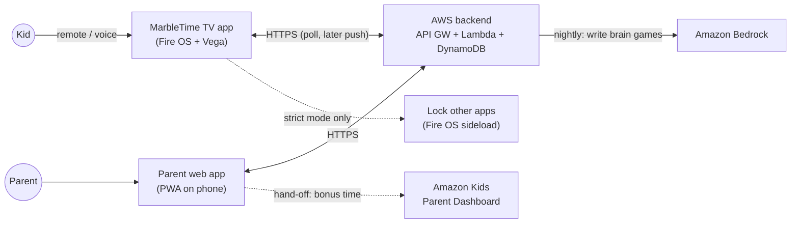
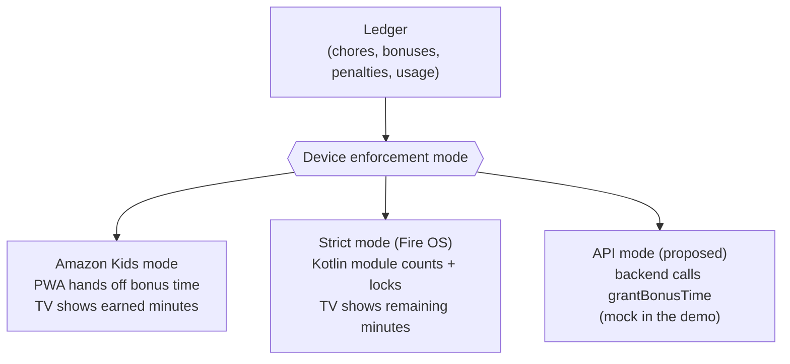
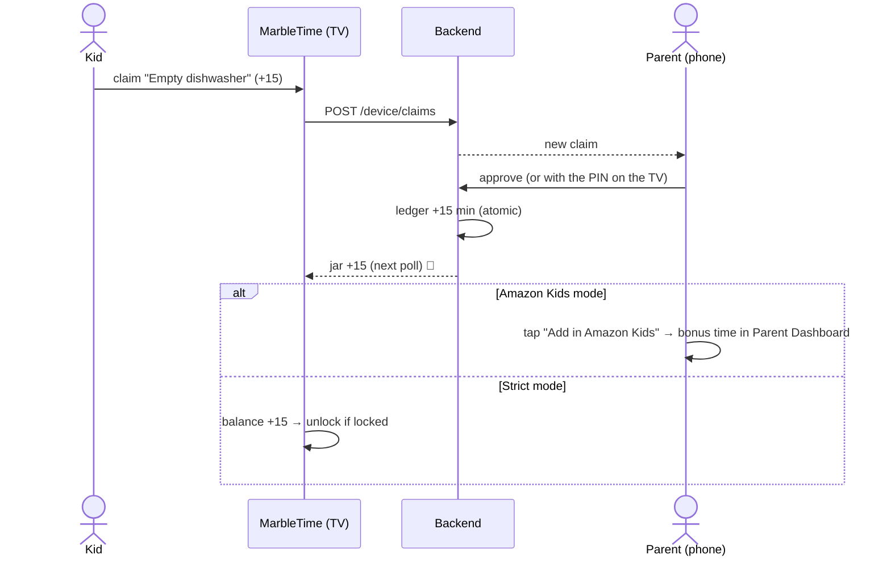
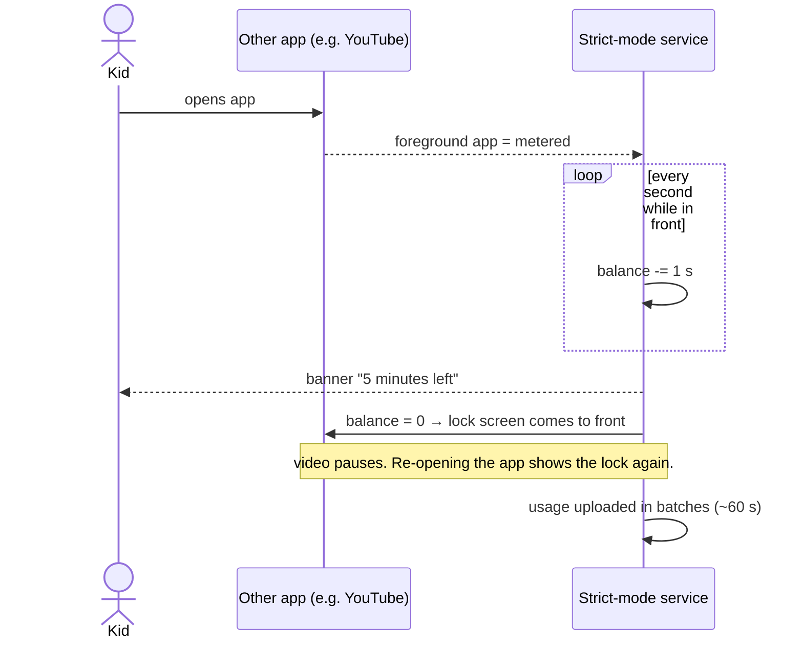
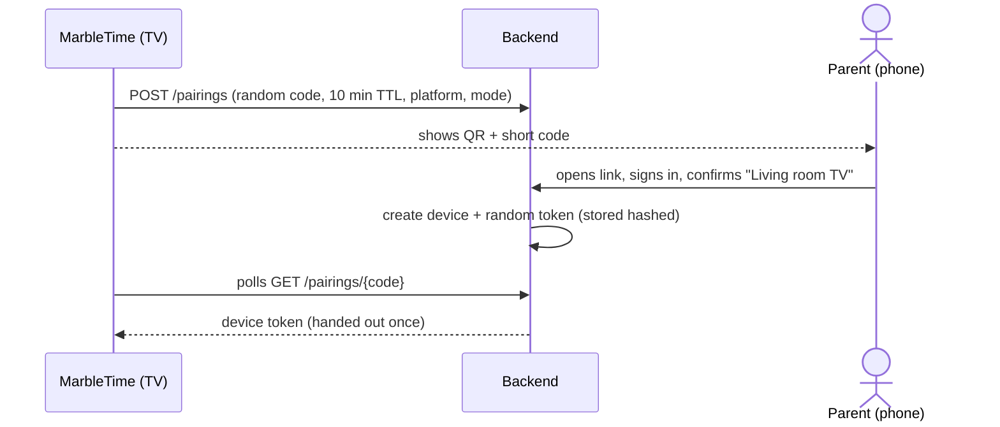
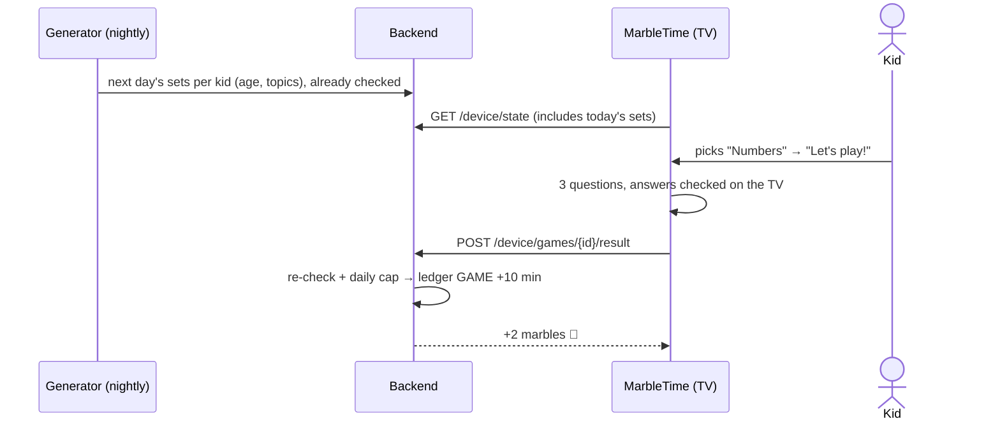
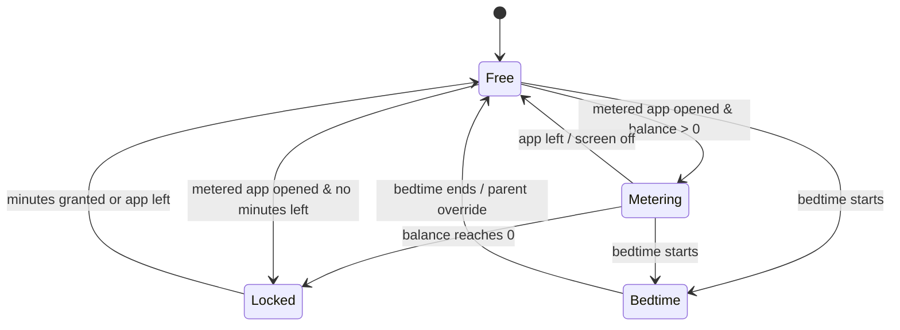
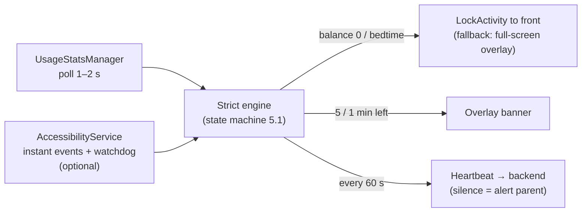

# 03 · Architecture

> **Stack:**
> - **React Native TV app** with shared screens, built for **Fire OS** (Expo TV) and **Vega**
> - a **Kotlin strict-mode module** in the Fire OS build only
> - a parent **PWA**
> - an **AWS serverless backend** (CDK: API Gateway + Lambda + DynamoDB + Cognito + Bedrock)
> - TV screens for young kids, by the rules in §12

## 1. Big picture



**Offline-first:**
- The TV keeps working when Wi-Fi drops. It caches state, and claims and usage go into an outbox.
- In strict mode, enforcement never waits for the network.

## 2. Components

| Component | Responsibilities | Tech |
|---|---|---|
| **TV app: shared** | "Who's here?" picker, board (jobs + brain games), marble jar, claim, celebration, brain-game screen, pairing QR, parent PIN mode, settings; API client and polling; reads the device's enforcement mode | `tv/packages/shared` (React Native + TS, `react-tv-space-navigation` for D-pad focus) |
| **TV app: Fire OS build** | Hosts the shared screens on Fire OS 8; bridge to strict mode | `tv/packages/expotv` (Expo TV / Android, armeabi-v7a) |
| **Strict-mode module** (Fire OS only) | Foreground service, usage watcher, accessibility watchdog, LockActivity, warning banner, start on boot, heartbeat | Kotlin local Expo module `expotv/modules/strict-mode` |
| **TV app: Vega build** | Hosts the shared screens on Vega; strict mode is a stub (`.kepler.ts`) | `tv/packages/vega` (React Native for Vega, `manifest.toml`) |
| **Parent PWA** | Sign-in, approvals, ± minutes, **Amazon Kids hand-off**, jobs, **brain-game settings** (age, topics, daily cap, preview), history, rules, optional **kid view** (claim from a family tablet) | React + Vite + TS; Cognito auth |
| **Backend API** | Families, kids, jobs, claims, brain-game sets and results, ledger (with hand-off status), devices and modes, pairing | API Gateway HTTP API + Lambda (Node/TS), DynamoDB single table |
| **AI** | Brain-game generator: short question sets for each kid's age in a fixed JSON shape, checked by code before any kid sees them (§11) | EventBridge (nightly) → Lambda → Bedrock (structured output) → validator → DynamoDB |
| **Infra** | One command deploys everything | AWS CDK (TypeScript) |

## 3. Enforcement modes

Each TV has a **mode**. The ledger is the same in every mode; only *who enforces* changes:



| | Amazon Kids mode | Strict mode | API mode (mock) |
|---|---|---|---|
| Daily base (each child's `dailyBaseMin`, default 30) | set the same daily limit in Amazon Kids | each day starts with it | the API |
| After approval | PWA shows **"Add 15 min in Amazon Kids"**, which opens `parents.amazon.com`; the parent marks it done | balance goes up → unlock | backend calls the mocked `grantBonusTime` |
| Penalty | netted against the next hand-off ("debt") | balance goes down (may go negative) | the API |
| TV shows | minutes earned today / this week, pending hand-offs | minutes remaining (live) | minutes remaining |

## 4. Core flows

### 4.1 Earning minutes (all modes)



### 4.2 Strict mode: spending and locking (Fire OS)



### 4.3 Pairing a TV (scan a QR code)



### 4.4 Brain games

> **Removed on Oct 7, 2026** (docs/08, Decisions): kids no longer earn time with brain games; jobs fill today's jar, and a job done once the jar is full earns a new character. Kept for the record.



- **No parent approval:** the app checks the answers. A daily cap per kid (a parent setting) keeps real-life jobs the main way to earn.
- **Amazon Kids mode:** `GAME` entries are handed off like approved jobs, so one "Add N min" tap covers both.
- **Offline, or the generator is late:** the TV uses the built-in question bank, and results sync later.

## 5. Strict mode internals (Fire OS only)

### 5.1 States



**Metered apps:** everything except an allowlist (MarbleTime, Fire TV home and settings, learning apps the parent picks).

### 5.2 Layers



1. **Detect the foreground app.**
   - **UsageStats** is the main signal.
   - **Accessibility** adds instant events and a **watchdog**: the system restarts an enabled service, which keeps ours alive on a 2 GB stick.
   - ⚠️ While accessibility is on, Prime Video stops auto-hiding its controls. The spike decides the default.
2. **Lock.** Bring the **LockActivity** to the front.
   - Starting it from the background is allowed because the app holds `SYSTEM_ALERT_WINDOW`.
   - The video app goes to the background and pauses. The D-pad works as normal.
   - Fallback: a full-screen overlay. On API 30 streaming apps can't hide overlays; on API 31+ they can, which is why LockActivity comes first.
   - The lock screen offers **"Do a chore"** (opens the chore board) and **"Ask a parent"**.
3. **HOME can't be intercepted, and we don't try.** Reopening the app re-locks it within ~1–2 s.
4. **Stay alive.**
   - A `START_STICKY` foreground service starts on boot.
   - The app is whitelisted from deviceidle.
   - A heartbeat goes out every 60 s. A force-stop removes the accessibility service, so silence → parent alert.
   - **Hardening:** use a Fire TV **kid profile**. Fire TV settings are blocked inside kid profiles, which closes the force-stop route. *(Verify our app runs in one: 06 §2.)*
5. **Setup:** one-time ADB grants (`scripts/fire.sh grant`, 06 §3).
6. **Never attempted:** replacing the launcher, catching HOME, device-owner/kiosk mode.

## 6. Ledger and time accounting

- **Append-only ledger.** Each entry is `{id, childId, deltaSec, type, reason, refId, createdBy, createdAt, handoff?}`. The type is one of `ALLOWANCE | CHORE | GAME | BONUS | PENALTY | USAGE | ADJUST`.
- **Atomic balance.** The balance is stored on the child item and updated **in the same DynamoDB transaction** as the ledger write. Client-generated UUIDs + conditional puts make retries harmless.
- **Daily base, positive first** (decided Oct 5, after reading the research on screen time as reward/punishment): every child has a daily base (`dailyBaseMin`) so TV isn't only a prize; jobs and games earn extra on top. The base is a setting, not a ledger entry. Taking minutes away only takes *earned* minutes and never goes below an empty jar (409 `empty_jar` when nothing is earned); the TV explains it with the parent's reason. Bonuses are celebrated on the TV.
- **Hand-off (Amazon Kids mode).**
  - Positive entries get `handoff: PENDING → DONE | SKIPPED`.
  - `GET /children/{id}/handoff` returns *pending minutes minus outstanding penalty debt*. That is what the PWA suggests adding in Amazon Kids.
- **Strict mode.** `USAGE` entries (idempotent, uploaded every ~60 s) and lazy `ALLOWANCE#child#YYYY-MM-DD` entries, so no cron is needed. The TV's local balance is the last server balance minus usage not yet uploaded.
- **Family rules** (edited on the phone):
  - daily allowance (strict mode)
  - balance cap
  - whether debt is allowed
  - bedtime (strict mode)
  - metered apps
  - per-chore limits (e.g. once per day)
  - brain games per kid: age, topics, daily marble cap, read aloud
  - enforcement mode per TV

## 7. Data model (DynamoDB single table)

| Entity | PK | SK | Main attributes |
|---|---|---|---|
| Family | `FAM#f` | `META` | name, timezone, rules |
| Parent | `FAM#f` | `PARENT#sub` | email, role |
| User → family | `USER#sub` | `FAM#f` | — |
| Child | `FAM#f` | `CHILD#c` | name, avatar, balanceSec, pinHash?, age, games `{topics, dailyCapMarbles, readAloud}` |
| Chore (job) | `FAM#f` | `CHORE#k` | title, minutes, icon, repeat, assignees |
| Claim | `FAM#f` | `CLAIM#<ts>#id` | childId, choreId, status, decidedBy |
| Game set | `FAM#f` | `GAMES#c#<date>#<topic>` | level, questions[], source (`ai` / `bank`), status, result |
| Ledger entry | `FAM#f` | `LEDGER#c#<ts>#id` | deltaSec, type, reason, refId, createdBy, handoff |
| Device | `FAM#f` | `DEV#d` | name, **platform** (`fireos`/`vega`/`web`), **mode** (`amazon_kids`/`strict`/`api_mock`), lastSeen, appPolicy |
| Device token (GSI1) | `TOKEN#<sha256>` | `DEV` | familyId, deviceId |
| Pairing (TTL) | `PAIR#code` | `META` | status, deviceId, one-time token |

## 8. API sketch (REST + JSON, contract in `backend/openapi.yaml`)

| Caller | Endpoint | Purpose |
|---|---|---|
| Parent (Cognito JWT) | `POST /families`, `GET /family` | family + rules |
| | `…/children`, `…/chores` (CRUD) | kids, chores |
| | `GET /claims?status=PENDING`, `POST /claims/{id}/approve\|reject` | approvals |
| | `POST /children/{id}/adjust {deltaMin, reason}` | bonus / penalty |
| | `GET /children/{id}/ledger`, `GET /children/{id}/handoff` | history; minutes to hand off to Amazon Kids |
| | `POST /ledger/{entryId}/handoff {status}` | mark a hand-off done or skipped |
| | `POST /pairings/{code}/confirm`, `GET/PATCH /devices…` | pairing, mode, app policy |
| | `PATCH /children/{id}` (age, game settings), `GET /children/{id}/games?date=…` | brain-game settings; preview the day's questions |
| TV / kid view (device token) | `POST /pairings`, `GET /pairings/{code}` | pairing |
| | `GET /device/state?since=…` | balances or earned minutes, jobs, today's game sets, rules, claim updates (poll target) |
| | `POST /device/claims` | claim a chore |
| | `POST /device/games/{id}/result` | a finished game: answers → `GAME` ledger entry (daily cap enforced) |
| | `POST /device/usage` | strict mode: batched, idempotent usage |
| | `POST /device/heartbeat` | liveness + installed apps (Fire OS) |
| Mock | `POST /mock-earned-time/grant` | stand-in for the proposed Amazon API ([07](07-earned-time-api.md)) |

**Real-time:** an **API Gateway WebSocket API** (`realtimeUrl` in `GET /device/state` and the PWA's `config.json`). TVs connect with `?device=<token>`, parents with `?token=<Cognito token>`. After any write a family can see, the backend sends each of its connections one `{"type":"changed"}`, and clients fetch their state at once (the TV with its ETag). The message carries no data, so nothing about the family travels outside authenticated HTTP. Polling stays as a safety net: the TV every 15 s with the socket up (3 s without, 30 s in the background), the PWA every 30 s (3 s without). **Web Push** (VAPID) tells parents when a kid claims a job; the key pair is made by the stack and the private key lives only in SSM Parameter Store.

## 9. Security and privacy (kids' data)

- **Kids have no accounts.** Only parents sign in. A child is a nickname and an animal avatar.
- **No photos and no personal data go to AI.** The brain-game generator gets only age, topics and level, never names. Bedrock does not train on inputs. Parents can preview every question set.
- **Device tokens:** 256-bit random, stored hashed, revocable. **Parent PIN:** salted hash, attempts rate-limited.
- **Data minimisation** in the spirit of COPPA/GDPR-K. Deleting a family deletes everything.

## 10. Repository layout (monorepo)

```
/tv                      React Native monorepo (Yarn 4 workspaces), from react-native-multi-tv-helloworld
  packages/shared        screens, components, API client, mode logic (*.android.tsx / *.kepler.tsx for platform bits)
    games/               brain-game screen template + built-in question bank (bank.json)
  packages/expotv        Fire OS build (Expo TV / Android)
    modules/strict-mode  Kotlin: service, usage watcher, a11y watchdog, LockActivity, banner, boot receiver
  packages/vega          Vega build (manifest.toml), strict-mode stub
/apps/demo-cartoons      tiny Android app playing a CC-licensed video: the metered app in tests and the video
/parent-web              React + Vite PWA (+ kid view)
/backend                 AWS CDK app + Lambda handlers (TS), openapi.yaml, brain-game generator + checks
/scripts                 fire.sh (adb), vega.sh (vega CLI), api-smoke.sh
/docs                    these docs
CLAUDE.md · FRICTION_LOG.md · FEEDBACK.md · FEATURE_REQUESTS.md
```

## 11. Brain games

> **Removed on Oct 7, 2026** (docs/08, Decisions): kids no longer earn time with brain games; jobs fill today's jar, and a job done once the jar is full earns a new character. Kept for the record.

**Who writes what:** parents write the real-life jobs. AI writes the brain games, and it only fills the slots of one fixed screen template (design canvas, screen 8).

**The template** (one screen for every game):
- Top row: topic (`numbers` | `words` | `puzzles`), progress (always 3 questions), reward (marbles).
- The question, always read out loud.
- A picture area with pictures from **our own set**, by name and count (`apple × 4`; `circle, triangle, …`). The AI never draws.
- Three answers in one row (numbers, words or pictures), so left, right and OK are all a kid needs.

**What the AI returns** (structured output, validated against a JSON schema):

```json
{
  "topic": "numbers",
  "level": "age-4-5",
  "questions": [
    {
      "prompt": "How many apples?",
      "say": "How many apples can you count?",
      "picture": { "kind": "count", "item": "apple", "n": 4 },
      "choices": ["3", "4", "5"],
      "answer": 1
    }
  ]
}
```

**Checks in code before any kid sees a set:**
- The schema matches, every picture name exists in our set, and the three choices are different.
- The answer is recomputed where code can do it (counts, sums, patterns). A mismatch drops the question.
- Length limits per age (e.g. at most 6 words in `prompt` for ages 4–5) and a word blocklist.
- A failed question is regenerated once. After that, the built-in bank fills the gap.

**Age → level profile** (parents set the age; first version):

| Age | Numbers | Words | Puzzles | Answers as |
|---|---|---|---|---|
| 4–5 | count to 10 | first sounds, rhymes (with pictures) | shape patterns | pictures, numbers |
| 6–7 | add and subtract to 20 | rhymes, simple spelling | patterns, odd one out | numbers, short words |
| 8+ | times tables, word problems | grammar: which word fits | sequences, logic | words |

**When:** sets are made nightly for the next day (EventBridge → Lambda), never while a kid waits. Parents can preview them in the app.

**Rewards:** marbles per game (default 2 = 10 min), with no parent approval because the app checks the answers. A daily cap per kid (default 4 marbles = 20 min) keeps real-life jobs the main way to earn.

**Wrong answer:** the tile fades with a small wiggle and the TV says "Try again!". No red, and no marbles are lost.

**Model:** chosen in M4. Claude on Bedrock supports structured output, and because code checks every set, the model can be swapped later.

## 11b. Characters (from Oct 7)

**Earning.** A job approved while the kid's jar is full gives a **character token** instead of marbles (docs/08, Decisions 4). The kid tells a grown-up what to make; the parent app records it (16 kHz mono WAV → `POST /speech-to-text`, Amazon Transcribe streaming, en-US; audio and words are never stored) or the grown-up types it.

**Making** (backend; `POST /children/{id}/characters`, then a background worker):
1. **Art director** (in the request, ≤ 12 s): the kid's words → a character card (what, up to 3 colours, outfit, mood, one detail) under a strict schema. Brands and known characters become original ones, scary things friendly; mild cartoon props are fine. Nothing usable → 422 with a kind sentence to read to the kid; the token is kept.
2. **Drawing worker** (at most 3 rounds): the drawing model draws from the card, never the raw words: one SVG with named parts (`body`, `head`, `eye-left`, `eye-right`, `mouth`, `arm-left`, `arm-right`, `legs`, `extra`) and their pivots. **Code checks** (parts, pivots, a filled mouth, left/right as the viewer sees them, standing on the floor, allowed elements) send the exact problems back for a repair. Then the SVG is sanitised and rendered to PNG (`@napi-rs/canvas`), and a **second model checks the picture** (friendly, original, matches the card); a "no" means a fresh drawing with the reason. If every round fails: `needs_help`, and the token goes back.
3. **Layers:** each named part becomes its own small SVG (same viewBox, its own gradients); a part drawn inside another names it as `parent`. Recompositing the layers reproduces the picture.

**Showing** (TV, `CharacterView`): the art is fetched once and kept on the device. Layers are drawn with react-native-svg and move around their pivots on the native driver: idle (breathe, blink, head tilt, arm sway), a cheer (two hops, arms flapping) when marbles land, a wave when it's new. The kid's newest character stands on their board; a new one is introduced once ("Your new character").

**Speaking:** lines are pre-written templates in the family's language (`characters.ts`: en, et, de, es), never AI-written; the TV asks `POST /device/speech` for each with the character's id. Gemini-TTS speaks it **in character**: the character's own Gemini voice (one of 12, picked by the art director) and a speaking style composed from fixed words (what it is, its mood, and its voice traits: pitch, pace, energy, texture, also picked by the art director), so the kid's idea never reaches the speech model as instructions. The audio is loudness-normalised to about −16 LUFS (like the read-aloud), returned as WAV with the mouth's opening every 40 ms, cached per character, language and text. The line plays after the read-aloud; MarbleAudio's `onLine` event starts the mouth.

**Listening:** none since Oct 19 (docs/08, Decisions Oct 19): the kid's idea is typed, on the TV or by a grown-up in the phone app. (Until then it was recorded on the parent's phone and transcribed by Gemini.)

**Models:** Gemini 3.8 Flash on Vertex AI for local runs; Bedrock (Claude Haiku 4.5) in the cloud once AWS lifts the account block (FRICTION_LOG). Measured before the art director and picture check existed: 100 of 100 drawings valid after at most one repair, median 23.5 s, p90 44 s, 1.26 ¢ each.

**Never:** a ready-made character swapped in, a copy of a known character, dialogue, scenes or AI-written words. Grown-ups can remove any character; the kid gets the token back.

## 12. TV design rules

The TV's screens are built for kids of about 4–8, many of whom can't read yet.

- **Time is marbles.** One gold marble = 10 minutes. Rewards show as marbles; minutes appear small, for parents. The jar is today's budget: its size is the kid's daily ceiling, and faint empty places show what jobs can still add (docs/08). Marbles grow with the jar's size, so a full jar of any size looks full to the top (6 big marbles for 60 minutes, 12 smaller ones for 120).
- **Gold** means only two things: time (marbles) and the main button.
- **The white ring** means only "selected" (D-pad focus).
- **Card colours mean nothing.** They only help kids tell cards apart.
- **Waiting for a grown-up** is shown only by an hourglass on the card.
- **One row.** Jobs sit in one row, so left/right and OK are enough. Picking the kid is its own screen ("Who's here?").
- **Each card shows what it gives now:** its marbles while today's jar has room; a sparkle (a new character) once the jar is full; a heart for a routine job (a thank-you, no marble). Only marbles are gold.
- **Few words, spoken.** 1–3 word labels, questions read out loud, one big action per screen.
- **The label under the selected card says what OK does:** "I did it!" (a grown-up checks).
- **Words:** the UI says "job" and "grown-up"; docs and code say "chore" and "parent".
- **Type and layout:** Fredoka; text at least 24 px at 1080p; 5% overscan-safe margins.
- **Any text must fit, and look good.** Names and jobs come from parents, character names from the AI, and four languages differ in length. Every such text uses `FitText`: the largest size that fits its box in N lines (and in the box's height, where it has one, like a card title above the marbles), and an ellipsis only at the minimum size. Check layouts with the stress family (`stress=1`).
- **Languages:** English, Estonian, German, Spanish (a family setting). Optional **CAPITAL LETTERS** for kid-facing text.
- **Positive first.** The jar shows the daily base plus what was earned. "Yay!" names the job and who noticed ("Feed the cat: done! – Dad"), never the kid's traits. A bonus from the phone is a "Yay!" with the parent's reason; minutes taken away show as a calm line with the reason on the kid's board for the rest of the day. No red, no sad sounds.
- **Motion marks the moments that matter, briefly** (`tv/packages/shared/src/marble/motion.tsx`): screens fade in; cards and answers arrive one after another; the selected item springs up and squishes on OK; "I did it!" pops the job in and turns the hourglass over; each marble lands with a clink and adds its 10 minutes to the clock as it lands. Transform and opacity only, on the native driver, so it stays smooth on the stick. Animations never block the remote: everything stays focusable and pressable while it moves.
- **Sounds** are short game effects (Android SoundPool via our `marble-audio` module), never a media session, so the remote's play/pause stays with the video apps.
- **Characters** (the kid's own, drawn from their words; docs/08): the newest stands at the top right of the board and idles (breathes, blinks, sways); on "Yay!" it hops when the marbles are in and says one short pre-written line in the family's language after the read-aloud, in its own voice, its mouth following the audio; a new one says hello once on its own screen. Up from the jobs selects the character on the board ("Play!"); OK opens the kid's **characters**: one row, the selected one comes alive, and each OK makes it wave or hop and say its next line. Never gold, no dialogue, no AI-written words. Chips in a few words say when one is being drawn or one is waiting to be asked for.
- **Read-aloud** is one warm narrator voice (Gemini-TTS) in all four languages: fixed phrases are recorded clips (`scripts/make-voices.py`); a family's own words (names, jobs, "done! – Dad", reasons) come from the backend in the same voice, made once and cached, and play in order with the clips. Characters' lines are made the same way, in each character's own voice. **Every line is checked before anyone hears it:** the voice gets a short description naming the language ("A native Estonian speaker: warm, clear and friendly, to a young child."; measured: without the language, "Jee!" came out as English "gee", and imperative instructions were sometimes read aloud), then Gemini listens back in that language. The transcript must match the line (letters compared, ≥ 0.85; right lines measured 0.96–1.00, wrong ones 0.25–0.69) and the speech mustn't run long (short lines were sometimes said twice), or it's made again. A line that never matches stays silent: no wrong words, no per-word rules. On by default; turning read-aloud off also silences the characters.
