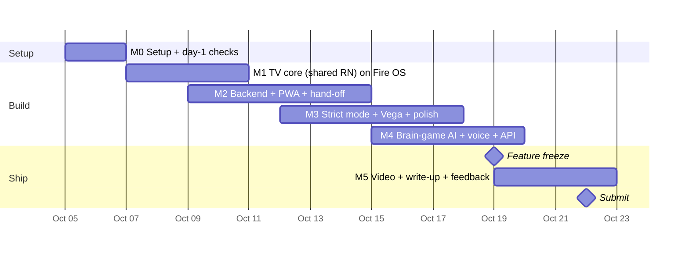

# 04 · Implementation plan (Mon Oct 5 → Fri Oct 23, 22:00 EEST)

> **Re-planned Oct 5.** M0 hadn't started, so each milestone moved by about three days; freeze and submit dates stay. What changed since Oct 2:
> - The TV is designed for young kids: the [design canvas](https://claude.ai/artifact/7Fs9Pa4bPtV1vzPfF2wLxh), rules in [03 §12](03-architecture.md#12-tv-design-rules).
> - **Brain games** written by AI were added ([03 §11](03-architecture.md#11-brain-games)).
> - The **photo check was dropped.** Parents approve on the phone or on the TV.

## Principles

1. **Answer the unknowns on day 1–2:**
   - Does Amazon Kids on your stick do what Amazon Kids mode needs?
   - Do the React Native builds run on Fire OS and on the Vega simulator?
   - Does strict mode lock reliably?
2. **Always have something to demo.** The TV core works **on its own** (PIN approvals, brain games from the built-in bank) on the stick by **Oct 10**.
3. **Fire OS first, Vega second.** If Vega isn't running by **Oct 12**, ship Fire OS only and call the shared code "Vega-ready".
4. **Feature freeze Mon Oct 19. Submit Thu Oct 22.**

## Timeline

## M0 · Setup and day-1 checks (Oct 5–6)

**You** (≈2 h total):
- Devpost + AWS credits.
- ~~Free ≥ 45 GB of disk.~~ ✅ 80 GB free (Oct 5).
- ADB on the TV.
- **The Amazon Kids checks** in 06 §2.
- ~~Run the Vega SDK installer.~~ ✅ SDK 0.24.12112 installed (Oct 5).
- `aws login`.
- Decide public or private repo.

**Agent:**
- Scaffold the monorepo from `react-native-multi-tv-helloworld`, plus `backend/` and `parent-web/` skeletons.
- Run the build checks below.
- Build a throw-away **strict-mode spike APK** (plain Kotlin, ported into the Expo module in M3).
- Use ScreenTamer as a *reading* reference only. It has no license, so don't copy code.

| # | Question | Who | Pass if |
|---|---|---|---|
| K1 | Does an Amazon Kids profile with a **daily limit** work on the 4K Plus? | You | The TV locks the kid profile at the limit |
| K2 | Does **bonus time** from the Parent Dashboard unlock it? | You | Unlocked within ~1 min |
| K3 | Can MarbleTime (sideloaded) be **added to the kid profile**? Does it count toward the limit? Can a kid open it **after** time's up (per-category limits)? | You + agent | Answers decide how kids claim when locked |
| R1 | Does the **Expo TV build** of the helloworld run on Fire OS 8 (32-bit) with D-pad focus? | Agent | Installs, runs, focus works |
| R2 | Does the **Vega build** run on the Vega Virtual Device? | Agent | App launches; keys and logs work |
| R3 | Does **text-to-speech** work in the Expo TV build on the stick (brain-game questions are read aloud)? | Agent | A test sentence is spoken |
| S1 | Does UsageStats see Netflix/Prime/YouTube in front, and how fast? | Agent | ≤ 2 s |
| S2 | Can LockActivity start from the background over those apps? | Agent + you (DRM is black in screenshots) | ≤ 2 s, video pauses |
| S3 | Home → reopen, *"Alexa, open …"* | Agent | Re-locks every time |
| S4 | Survives a reboot and 2 h idle, with and without the accessibility watchdog? | Agent | Back ≤ 60 s after boot |
| S5 | Does the Prime Video controls problem appear with accessibility on? | You | Decides the default |
| S6 | Force-stop → heartbeat alert? Does the kid profile block Settings? Does local ADB (`127.0.0.1:5555`) work for setup without a computer? | Agent | Alert ≤ 2 min; notes in the spike results |

**Decision gate (Oct 6):**
- **K1–K2 fail** → Amazon Kids mode falls back to "pause/resume and daily-limit edits". The pitch leans harder on the API ask.
- **R1 fails** → Kotlin-only TV app (02 §2 option B).
- **R2 fails** → Fire OS first; retry Vega in M3.
- **R3 fails** → pre-recorded audio for the built-in bank; questions from the AI get spoken by a cloud voice (Amazon Polly) instead.
- **S fails** → strict mode becomes a "lite" demo; the API mock carries the automatic story.

Results go in `docs/spike-results.md` and the friction log.

## M1 · TV core on Fire OS, local only (Oct 7–10)

- [ ] **Shared screens** (`tv/packages/shared`), as on the design canvas:
  - "Who's here?" kid picker
  - the board: jobs and brain games in one row, and the marble jar
  - "I did it!" → "A grown-up will check" (waiting = an hourglass on the card)
  - **grown-ups PIN mode** (Yes / Not yet, ± time with a reason, edit jobs)
  - "Yay!" celebration: the marbles drop into the jar
  - the **brain-game screen** (one template, [03 §11](03-architecture.md#11-brain-games)) with a **built-in question bank**: 3 topics × 3 age bands
  - settings
- [ ] Local persistence (AsyncStorage), debug hooks, D-pad focus with `react-tv-space-navigation`, read-aloud
- [x] "Demo Cartoons" test app (`apps/demo-cartoons`, Kotlin): plays *Big Buck Bunny* (CC BY 3.0) full screen from Wikimedia Commons, with the credit on screen; OK pauses. The metered target in strict-mode tests and the demo video. Installed on the stick.
- [ ] Quick Vega parity check on the simulator at the end of the week

**Done when:** on the stick alone, a kid claims a job, a grown-up approves with the PIN, and the marbles drop; and a kid plays a 3-question game and gets its marbles.

### M1 status and additions (Oct 5)

Done early on the stick (screens from the canvas, PIN approval, built-in brain games, 17 unit tests). Added on Oct 5 at the user's request:

- [x] **Four languages: English, Estonian, German, Spanish.** Every TV text sits in one translation table (`tv/packages/shared/src/marble/i18n.ts`); the family language is a grown-ups setting. The word puzzles are written per language. ⚠️ A native speaker reviews et/de/es before the video.
- [x] **Capital letters setting** for kid-facing text (many young kids learn capitals first).
- [x] **Any text fits** (names and jobs are user content; AI writes questions; four languages): `FitText` shrinks to fit N lines and only then cuts off. The stress-test link `scripts/fire.sh open 'stress=1&screen=who'` loads a worst-case family. Lines may break after a hyphen (double names like Mari-Liis).
- [x] **Marble value** shown under the jar ("● = 5 min").
- [x] **Sound effects** on Fire OS (marble clinks timed to the physics, lid, yay, right, try again, tap; synthesised by `scripts/make-sounds.py`, MP3). Played by our own small native module (`tv/packages/expotv/modules/marble-audio`, Android SoundPool): `expo-audio` gave every player a media session, so MarbleTime kept the remote's play/pause after Home.
- [ ] Sound effects and read-aloud on Vega (M3): `@amazon-devices/react-native-w3cmedia` `AudioPlayer` with our MP3s. (`keplerscript-audio-lib` only plays built-in system sounds or raw PCM streams.)
- [ ] **Vega parity (Oct 5 check):** the Vega build runs the new code (screens, focus, entrance motion, icons). Scripted OK presses on the VVD only deliver `onPressIn` (FRICTION_LOG), so check presses, saved state and the game by hand with the on-screen remote.
- [x] **Read-aloud in four languages** on Fire OS: recorded clips only, nothing synthesised on the TV. `scripts/make-voices.py` asks the app for every line it speaks (`spokenLines()`), records the new ones (Polly neural Ruth/Vicki/Lucia for en/de/es, TartuNLP Neurokõne "mari" for Estonian, terms to confirm before launch), evens out loudness and writes `voices.ts`. 44 lines × 4 languages, ~2 MB. The TV says "Who's here?", each card's name as the D-pad lands on it, "Great job, Mia! A grown-up will check.", why marbles came, each question, "Try again!" and the praise; the speaker button repeats the question. A line without a clip is skipped (no robot voice); in M2 the backend records each family's names and jobs. Grown-ups can turn "Read aloud" off. Pico is no longer needed. Estonian stays on Neurokõne "mari" for now (the user finds all Neurokõne voices weak); the upgrade path is Google Chirp 3 HD `et-EE` (free under 1M characters a month; Polly has no Estonian, see FEATURE_REQUESTS.md). Line endings are kept whole: the clip keeps its natural fade plus 300 ms of silence.
- [x] **Marble physics** (seeded, computed up front, played back natively) and the jar lid opening and closing.
- [x] **More animations at key moments**: claim, right and wrong answers, counting, approval, Yay with the minutes counting up as marbles land, PIN shake, focus spring (rules in [03 §12](03-architecture.md#12-tv-design-rules)). Checked frame by frame on the stick with `screenrecord`.
- [x] **Job icons:** 43 icons (5 of ours + 38 from Lucide, ISC, see THIRD_PARTY_NOTICES.md), each with a hint for the AI (`JOB_ICONS` in `data.ts`); the AI picks one per job in M2, the parent can change it. AI-drawn icons in our style only as an extra.
- [x] Remember state across app restarts (AsyncStorage on both platforms; everything except the screen; the daily game cap resets at local midnight). Checked on the stick with a force-stop.

## M2 · Backend, parent PWA and Amazon Kids hand-off (Oct 9–14)

Added on Oct 5: the parent app speaks the same four languages; **recurring jobs** (every day, or chosen weekdays; at most once per day; back on the TV board when due); length limits on names and job titles as a second safety net; the AI picks each job's icon from our set.

- [x] `backend/openapi.yaml` (contract first), then the CDK stack (written and synthesised; **not deployed yet**, waiting for the user's go):
  - HTTP API, one Lambda, DynamoDB single table
  - Cognito (managed login, code + PKCE), S3 + CloudFront for the PWA
  - $10 budget alarm (when an email is given)
- [x] Endpoints in 03 §8, including **hand-off**, **device mode**, **game results** and **game settings**. 143 tests (also run against DynamoDB Local) + `scripts/api-smoke.sh`. Local dev server: `cd backend && npm run dev -- --seed`.
- [x] **PWA** (`parent-web/`, 48 tests, four languages), tried by the user on a phone over Wi-Fi:
  - sign-in (Cognito, or a name against the dev server), onboarding
  - pair TV (QR link or typed code), approvals inbox (one tap, no photos), ± minutes
  - jobs (repeat: every day, chosen weekdays, once), history
  - brain-game settings per kid: age, topics, daily cap (read aloud is family-wide for now)
  - **"Add N min in Amazon Kids"** step (opens `parents.amazon.com`, then mark done). It adds up approved jobs **and** game marbles.
  - [ ] optional kid view
- [x] **Daily base, positive first** (decided Oct 5 after reading the research on screen time as reward/punishment): each kid has a daily base (default 30 min) on top of which jobs and games earn; "Give minutes" is the main action; taking away only takes earned minutes, never below an empty jar, with a reason the TV shows calmly; bonuses get a "Yay!" on the TV. Checked end to end on the stick.
- [x] **TV:** pairing screen (QR), sync (state poll every 3 s, claim and game-result upload), outbox kept across restarts, the family's own PIN. Checked on the stick against the local backend: a claim reaches the backend in 1.5 s; an approval comes back as "Yay!".

**Done when:**
- A claim on the TV shows up on the phone, is approved, and the TV updates within ≤ 5 s.
- The hand-off works with a real Amazon Kids profile.

## M3 · Strict mode, Vega and polish (Oct 12–17)

- [ ] **Strict-mode Expo module** (Kotlin, ported from the spike):
  - service, usage watcher, optional accessibility watchdog
  - LockActivity = the "Jar is empty" screen, with "Do a job" / "Ask a grown-up"
  - banner, boot start, heartbeat → "TV not reporting" alert
  - metered-apps picker on the phone
- [ ] **Vega build:** shared screens, pairing and sync on the simulator. Platform bits in `.kepler.tsx` (QR, storage).
- [ ] Polish: focus states, sounds, the marble-drop animation, empty and error states
- [ ] Full pass of the [06](06-device-testing.md) checklists

**Cut line Oct 12:** if Vega isn't running → Fire OS only, and the "Vega-ready" claim goes in the write-up.

## M4 · AI, voice and the API story (Oct 15–19), in priority order

1. **Brain-game generator** ([03 §11](03-architecture.md#11-brain-games)): a nightly Lambda → Bedrock (structured output) → code checks → DynamoDB. The TV swaps the built-in bank for the generated sets, and parents can preview them. Targets AWS Builder.
2. **Voice claim.** Either an Alexa custom skill (dev stage, your devices) or a **chores MCP server** + web "Alexa+ simulator", which is also eligible for the Alexa+ track. In Amazon Kids mode it is also how kids claim while the TV is locked.
3. **Earned Time API mock + adapter.** `mode = api_mock` shows the automatic flow without sideloading. Finalize [07](07-earned-time-api.md).
4. **Open-source extraction** of the strict-mode module (MIT, tests) for the Open Source mini-challenge.
5. Push via AppSync Events instead of polling, if there's time left.

## M5 · Ship it (Oct 19–22)

- [ ] Demo video (storyboard below), uploaded public on YouTube
- [ ] README: what it is, modes, architecture diagram, **setup and run instructions** (Fire OS + Vega), license
- [ ] Devpost text
- [ ] FEEDBACK.md (per tool: Fire OS/ADB, Expo TV, Vega SDK/VVD, ADBT MCP, CDK/Lambda/DynamoDB/Cognito/Bedrock)
- [ ] FEATURE_REQUESTS.md (**Earned Time API: Critical**)
- [ ] FRICTION_LOG.md entries
- [ ] Repo access: public + license, or reviewer invites (they expire after 7 days)
- [ ] Submit **Oct 22**. Keep the backend running through **Nov 20**.

### Demo video storyboard (< 3:00)

| Time | Shot |
|---|---|
| 0:00–0:15 | The problem: screen time is a daily negotiation. Amazon Kids gives limits, not motivation. |
| 0:15–0:35 | On the stick: "Who's here?" → Mia's board. She picks "Toys away" with the remote: "I did it!" |
| 0:35–0:55 | Parent's phone: one tap on "Yes" → the marbles drop into the jar on the TV 🎉 |
| 0:55–1:20 | A brain game: "Numbers" for a 5-year-old, made by AI, read out loud, checked by the app → 2 marbles at once. Then the parent's settings: age, topics, daily cap. |
| 1:20–1:50 | **Strict mode** (labelled "Fire OS prototype"): Demo Cartoons counts down → 1-min banner → "Jar is empty" lock → "Do a job" → approve → unlocks by itself |
| 1:50–2:10 | **Appstore mode:** the same app on the Vega simulator. The parent taps "Add 15 min in Amazon Kids". |
| 2:10–2:30 | How it works: one React Native codebase (Fire OS + Vega), Kotlin strict module, AWS + Bedrock (AI writes the games, code checks them) |
| 2:30–2:55 | The ask: the **Earned Time API**. One call, and every Fire TV family gets this safely, on Fire OS and Vega. |

## What to cut if we're behind

| When | If behind | Cut |
|---|---|---|
| Oct 12 | Vega not running | Fire OS only + "Vega-ready" |
| Oct 14 | Backend late | Demo local mode (PIN + ticket codes). The hand-off is just the parent opening the Parent Dashboard. |
| Oct 16 | AI or voice late | Drop voice first. If the generator is late, games keep the built-in question bank. |

**Never cut:**
- the claim → approve → marbles loop on the stick
- one playable brain game (the built-in bank is enough)
- strict-mode lock and unlock
- the video quality
- the API write-up

## Risks

| Risk | Likelihood | Impact | Mitigation |
|---|---|---|---|
| Amazon Kids on Fire TV lacks bonus time or per-category limits | Med | Med | Day-1 checks K1–K3; fall back to pause/limits; it strengthens the API ask |
| Expo TV build trouble on Fire OS 8 (32-bit) | Low–Med | High | Day-1 check R1; Kotlin fallback |
| Vega toolchain friction (disk, simulator) | Med | Med | Cut line Oct 12; every snag goes into the friction log (bonus) |
| Strict mode is less reliable than research suggests | Low | Med | Spike S1–S6; API-mock demo |
| Judges see strict mode as breaking policy | Med | Med | Label it a *prototype of the API*; the core ships compliant |
| Prime Video controls stop auto-hiding (accessibility on) | High | Low | Accessibility watchdog off by default if needed |
| AI writes a wrong or unsuitable question | Med | High | One fixed template; code re-checks answers and word limits; pictures only from our own set; parent preview; built-in bank as fallback |
| Young kids can't follow the screens | Med | High | Watch a child try it in M1 if you can (5 minutes, no help); read-aloud on by default |
| Scope creep | High | High | Priority order in M4, freeze Oct 19 |
| AWS setup friction or cost | Med | Med | One-command CDK deploy, $10 budget alarm, $150 credits |
| Video breaks the trademark rule | Med | Med | Demo Cartoons (CC content); no Netflix on screen |
| Mac disk full | Low (80 GB free on Oct 5) | High | Keep ≥ 45 GB free; extra candidates in 05 §2 |
