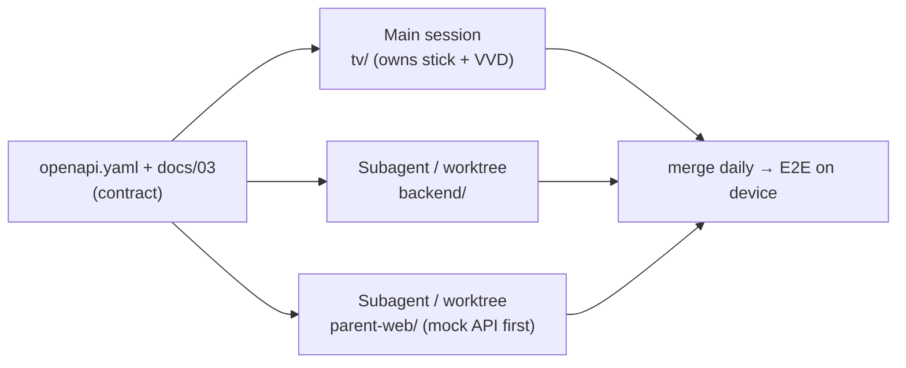

# 05 · Agent playbook: how Claude Code builds this

## 1. How we split the work

- **The agent (Claude Code) writes nearly all the code:**
  - the TV monorepo (shared screens, Fire OS build, Vega build)
  - the Kotlin strict-mode module
  - the backend, the PWA, the scripts and the docs
  - the hackathon paperwork: friction log, feedback, feature requests
- **You** do what only a human can:
  - accounts and logins
  - installers that ask questions (the Vega SDK)
  - approving prompts on the TV
  - the Amazon Kids checks
  - judging DRM apps by eye
  - the phone side
  - recording the video
- **Two feedback loops with no human in them:**
  - **Fire OS** on your stick over Wi-Fi ADB
  - **Vega** on the Vega Virtual Device (VVD) on the Mac

  In both, the agent builds, installs, presses remote keys, captures the screen, reads logs and fixes.
- **The API contract comes first.** `backend/openapi.yaml` and [03](03-architecture.md) are the source of truth, so agents working in parallel can't drift apart.
- **Logic is kept testable.** Ledger and hand-off math, plus the strict-mode engine, are pure TS/Kotlin with unit tests. Device behaviour is checked by scripted scenarios.

## 2. Your Mac today (checked 2026-10-02)

| Tool | Status |
|---|---|
| Android Studio, Android SDK (API 30–36), adb, JDK 17 | ✅ |
| Node 22, npm, git, gh, Homebrew, Python 3 | ✅ |
| Yarn 4 (the TV monorepo needs it) | ✅ Corepack enabled into `~/.local/bin` (Oct 5); the repo's `packageManager` field picks Yarn 4 |
| **Vega SDK + Vega Virtual Device** | ✅ SDK 0.24.12112, Vega CLI 1.4.2 and the virtual device, installed Oct 5 (unattended, `NONINTERACTIVE=true`, commands in [06 §4](06-device-testing.md#4-vega-virtual-device-simulator)). Telemetry is on by default ([opt out](https://developer.amazon.com/docs/vega/latest/telemetry.html)). |
| AWS CLI v2 | ✅ 2.37.9 (Oct 5). Still to do: **you** run `aws login`. CDK runs through `npx aws-cdk`. |
| **Free disk** | ✅ **80 GB free on Oct 5** (25 GB on Oct 2). Target ≥ 45 GB: the Vega SDK needs 20 GB, plus RN/Gradle builds. |

**Disk you could free if needed (your call, nothing deleted yet), about 40 GB in total (sizes checked Oct 5):**

| What | Size | Note |
|---|---|---|
| Phone emulator images `system-images/android-{28,32,33,34,36}/google_apis*` | ~25 GB | Not needed for TV work. Remove in Android Studio → SDK Manager. **Keep `android-34/google-tv`** (8 GB) as an Android TV emulator backup. |
| `~/.gradle/caches` | 10 GB | Safe to delete; it re-downloads what it needs |
| `~/.android/avd/godot34.avd` | 5.3 GB | An old Godot emulator, if you don't need it |

## 3. One-time setup checklist

| # | Who | Step |
|---|---|---|
| 1 | You | Devpost registration and the **$150 AWS credits** form (deadline Oct 21) |
| 2 | You | Free disk (§2) |
| 3 | You | TV: ADB debugging + approve the Mac; the Amazon Kids checks ([06 §1–2](06-device-testing.md)). Send the TV IP. |
| 4 | You | Install the **Vega SDK**. Allow **Screen Recording** for your terminal app (System Settings → Privacy & Security) so the agent can screenshot the VVD window. |
| 5 | You | `brew install awscli && aws login`. The agent then runs `npx aws-cdk bootstrap` and adds a **$10 budget alarm**. |
| 6 | You | Public repo + MIT license, or private + reviewer invites |
| 7 | Agent | Scaffold the monorepo (03 §10) from `AmazonAppDev/react-native-multi-tv-helloworld`; `CLAUDE.md`; `scripts/`; `.env.local` (`FIRETV=<ip>:5555`) |
| 8 | Agent (you approve) | Install **Amazon Devices Builder Tools** (§4) |

## 4. Amazon Devices Builder Tools (MCP + skills): worth installing now

- **Package:** `@amazon-devices/amazon-devices-buildertools-mcp`. Docs: <https://developer.amazon.com/docs/adbt/get-started>.
- **It's genuinely useful now that we target Vega.** Skills for Vega setup, build-and-run, developer mode, **focus management, navigation, UI components**; documentation search; Vega crash and performance tools; plus Fire OS docs and workflows.
- **Install for Claude Code:**
  ```bash
  npx -y @amazon-devices/amazon-devices-buildertools-mcp@latest init-context --agent claude-code-cli
  ```
  This adds a user-scope MCP server, installs about 19 skills into `~/.claude/skills/` and merges a block into `./CLAUDE.md`. The alternative is a project `.mcp.json` with `{"mcpServers":{"amazon-devices-buildertools-mcp":{"command":"npx","args":["-y","@amazon-devices/amazon-devices-buildertools-mcp@latest"]}}}`.
- **Don't pin a default platform** in `.adbt-config.json`, because we target both.
- **Installed Oct 20** (1.0.17) in agent mode: `init-context -a claude-code-cli --install-agent -f`, run outside the
  repo. The default steering document would go into `CLAUDE.md`, but it is Amazon's (the package is UNLICENSED) and
  asks for a six-step setup before the first answer of every session. The skills load at once, the MCP server from
  the next session. Until then a tool runs with `npx -y @amazon-devices/amazon-devices-buildertools-mcp@latest exec
  <tool> --args '<json>' > file` (into a file: piped output stops at 64 KB). `.adbt-config.json` maps each package to
  its platform.
- **Node:** 18–24 (your 22 is fine; 26 breaks it).

**Other references:**

- `react-native-multi-tv-helloworld`: the base. Expo 55 / react-native-tvos 0.83 + Vega RN 0.83, shared package, `.kepler.tsx` files for Vega.
- `react-native-multi-tv-app-sample`: a richer UI to borrow from (drawer, grids, settings). Its Vega app is older (RN 0.72).
- `hello-world-fire-tv` (Kotlin): reference for the Android parts of strict mode.
- `bageshwar/screentamer-tv`: Fire TV enforcement reference. **It has no license, so read it and never copy.**
- `AmazonAppDev/devices-agent-skills`: React Native TV UI skills (`npx skills add …`).

## 5. The device loops: what the agent runs

### Fire OS: your stick

```bash
yarn expotv:prebuild && (cd tv/packages/expotv && npx expo run:android --device $FIRETV)  # or a release build + adb install
adb -s $FIRETV shell am start -n app.marbletime.tv/.MainActivity
adb -s $FIRETV shell input keyevent KEYCODE_DPAD_DOWN KEYCODE_DPAD_CENTER   # drive the UI
adb -s $FIRETV exec-out screencap -p > .shots/home.png                     # the agent looks at it
adb -s $FIRETV logcat -d -s MarbleTime:* Strict:* ReactNativeJS:*             # assert on logs
```

### Vega: simulator on the Mac

```bash
yarn vega:build                                    # → tv/packages/vega/build/aarch64-debug/*.vpkg
vega virtual-device start
vega run-app <vpkg> app.marbletime.tv.main -d VirtualDevice
vega exec vda shell "inputd-cli button_press KEY_DOWN"           # remote keys
vega exec vda shell "loggingctl log -f --vpkg app.marbletime.tv"    # logs
screencapture -x -l <vvd-window-id> .shots/vega-home.png         # macOS capture; needs Screen Recording permission
```

These get wrapped in `scripts/fire.sh` and `scripts/vega.sh` (`connect|install|grant|launch|keys|shot|logs`).

**Built into the app so the agent can check it alone:**

- **Debug fast clock** (1 min = 1 s) for strict-mode warnings, locks and bedtime.
- **Debug intents** to grant minutes or fake an approval without the backend.
- **Structured log lines** (`Strict: state=Locked fg=… bal=0`) so checks run on logs.
- **"Demo Cartoons"**: a CC video app as the metered target. Screenshots can see it (unlike DRM apps), and it is safe to show in the video.

**Hardware facts:**

- 4K Plus = **Fire OS 8, API 30, 32-bit (armeabi-v7a)**. Keep `minSdk ≤ 30` and build armeabi-v7a.
- Fire OS 8 shows "Are you still watching?" after 4 h without input.

## 6. Backend and web loop

- **Backend:**
  1. Vitest unit tests (ledger, hand-off netting, pairing).
  2. `npx aws-cdk deploy` to `dev`.
  3. `scripts/api-smoke.sh`.
  4. Tear down or scale down when idle; **keep it up from Nov 9 to Nov 20** for judging.
  5. Bedrock is stubbed in unit tests and called for real only in integration checks.
- **Parent PWA:** `npm run dev`, with visual checks through Chrome automation at phone width. You try the deployed URL on your phone.
- **End-to-end script:** pair a fake device → claim → approve → assert jar → hand-off pending → mark done.

## 7. Running agents in parallel



- **One agent drives the stick or the VVD at a time.** Each directory has one owner. Contract changes go to `openapi.yaml` first.
- **The PWA starts against a mock server** generated from the contract, so it doesn't wait for the backend.
- **Optional:** you can explicitly ask for a multi-agent *workflow* for a big parallel push. It costs more tokens.

## 8. What needs you, and when

| When | You |
|---|---|
| Day 0–1 (Oct 2–3) | Setup checklist §3 (≈2 h including the Vega SDK and Amazon Kids checks) |
| Oct 4 | Watch the strict-mode lock over Netflix, Prime and YouTube (DRM is black in screenshots). Make the go/no-go call. |
| M2–M3 | Use the PWA on your phone (approve, hand off to Amazon Kids). Tell the agent what feels clunky. |
| Any time | Re-accept the ADB prompt after TV updates if asked |
| Oct 19–22 | Record the video (the agent writes the script and shot list and captures TV and VVD footage), fill the Devpost form, set repo access |

## 9. Paperwork the agent keeps current (worth points)

- **`FRICTION_LOG.md`** (up to +10% bonus). One entry per real snag: task · steps · expected vs actual · severity · workaround · suggestion. Vega and Expo-on-Fire-OS will give plenty of material.
- **`FEEDBACK.md`**, per tool: Fire OS/ADB, Expo TV, Vega SDK/VVD/CLI, ADBT MCP and skills, CDK, Lambda, DynamoDB, Cognito, Bedrock.
- **`FEATURE_REQUESTS.md`:**
  - **Critical:** the **Earned Time API** ([07](07-earned-time-api.md))
  - **Important:** a settings UI for trusted family apps' permissions on Fire OS
  - **Nice-to-have:** a keep-awake API for non-media Vega apps

## 10. Suggested `CLAUDE.md` skeleton

```markdown
# MarbleTime: family chore board + earned screen time on Fire TV (hackathon, deadline 2026-10-23 12:00 PDT)
Docs: docs/ (README first; architecture docs/03; plan docs/04; API ask docs/07). API contract: backend/openapi.yaml.
## Modes
amazon_kids (Appstore, Fire OS + Vega) · strict (Fire OS sideload, Kotlin module) · api_mock (proposed Earned Time API)
## Commands
- TV (Fire OS): scripts/fire.sh install|grant|launch|keys|shot|logs   (stick in .env.local FIRETV=…)
- TV (Vega): scripts/vega.sh build|run|keys|shot|logs                  (Vega Virtual Device)
- Backend: cd backend && npm test && npx aws-cdk deploy --context stage=dev
- Web: cd parent-web && npm run dev
## Rules
- Verify every TV change on the stick or VVD (screenshot or log check) before saying it's done.
- Shared code stays platform-neutral; platform bits go in *.android.tsx / *.kepler.tsx.
- Ledger/hand-off/strict-engine changes need unit tests. Contract changes: openapi.yaml first.
- Log every tool/doc snag in FRICTION_LOG.md as it happens. No secrets or real kids' photos in git.
- Never copy code from bageshwar/screentamer-tv (no license).
```

## 11. Example prompts for each milestone

- *"M0: scaffold the monorepo per docs/03 §10, then run the day-1 checks R1, R2 and S1–S6 from docs/04. Write the results to docs/spike-results.md."*
- *"M1: build the shared TV screens (chore board, jar, claim, PIN mode, celebration). Verify on the stick, then on the VVD."*
- *"M2: write backend/openapi.yaml from docs/03 §8, build the CDK stack and handlers with tests, deploy to dev, run the smoke test. Then the PWA, including the Amazon Kids hand-off."*
- *"M3: port the strict-mode spike into the Expo module; run the 06 strict-mode checklist on the stick."*
- *"M5: draft the demo script, Devpost text, FEEDBACK.md, FEATURE_REQUESTS.md and the friction-log entries from what we did."*
