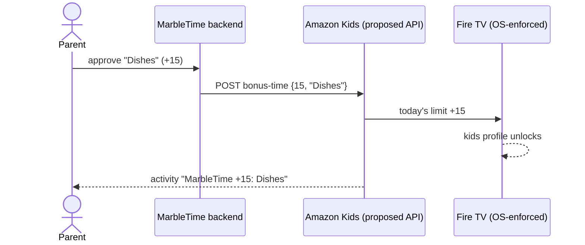

# 07 · Feature request: an "Earned Time API" for Fire TV (Fire OS + Vega)

**Priority:** Critical. It goes into `FEATURE_REQUESTS.md` and the Devpost "Feature requests" field. MarbleTime's strict mode and `api_mock` mode exist to prove the case.

## The problem

- **Families want screen time to be *earned*:** chores, homework, reading, exercise.
- **Amazon Kids already has the building blocks:** daily limits, bedtime, *Learn First*, and since Sept 24 2026 one-tap **bonus time** in the Parent Dashboard. But only a parent's manual tap can add time.
- **Third-party apps can't read or grant Amazon Kids time.** The only way for an app to enforce time is a lock screen plus permission tricks. That is:
  - banned by the Device & System Abuse Policy
  - impossible on Vega
  - only reachable on Fire OS through ADB
- **The result:** there are no "earn your screen time" apps on Fire TV, and parents juggle two apps.

## The proposal

### 1. Cloud API, authorized through Login with Amazon and consented by a parent

| Call | Purpose |
|---|---|
| Scope `amazon_kids:screen_time:earn` | Granted by a parent **per child profile, per app**, in the Parent Dashboard. Comes with a daily cap and can be revoked. |
| `GET /kids/v1/profiles` | Child profiles the parent shared with this app (id, display name) |
| `GET /kids/v1/profiles/{id}/screen-time` | Today's limit, used, remaining, bedtime window |
| `POST /kids/v1/profiles/{id}/bonus-time {minutes, reason, idempotencyKey}` | Grant bonus time, capped. It shows in Parent Dashboard activity as *"MarbleTime +15 min: emptied dishwasher"*. |
| Events `screen_time.exhausted`, `screen_time.granted` | Let the app react, e.g. show "earn more" on the TV |

### 2. On-device API (Fire OS SDK + a Vega module)

| Call | Purpose |
|---|---|
| `getRemainingTime(profile)` | The TV shows real remaining minutes, not just earned ones |
| `onTimeExhausted(listener)` | The app knows when the OS has locked the profile |
| **"Allowed while locked"** (parent setting) | A parent lets one app (e.g. MarbleTime) stay open when time is up, so kids can claim chores or learn. The **system** lock screen shows *"Earn more time in MarbleTime"*. |

## Why it's safe

- **Parent consent** per child and per app; revocable; daily caps; every grant visible in Parent Dashboard activity.
- **The OS enforces.** No third-party lock screens, overlays or accessibility tricks, so it fits the Device & System Abuse Policy.
- **Minimal kids' data:** a profile id and a display name, parent-authorized, in line with COPPA.
- **Works the same on Fire OS and Vega,** and on Fire tablets and Echo Show, since it's one Amazon Kids backend.

## Who else benefits

- **Education apps:** "learn to earn" (finish a lesson → +10 min). That extends *Learn First* to third-party content.
- **Fitness apps:** "move to earn".
- **Reading apps.**
- **Chore and allowance apps:** MarbleTime and others.

## What we built to make the case

- **Strict mode** (Fire OS prototype) shows the experience families would get: approve on the phone → the TV unlocks by itself.
- **`api_mock` mode** runs MarbleTime against a mock of the calls above (`POST /mock-earned-time/grant`), so the integration is ready the day an API exists.

## Open questions for Amazon

- Should grants be **today only** or **banked** (carried over)?
- What's a sensible default **per-app daily cap**?
- How can "allowed while locked" be exposed without letting any app keep kids on screen?
