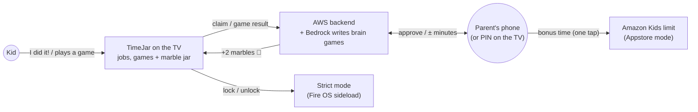

# TimeJar (working title): the family chore board on your TV

*Hackathon:* **Build, Ship, Shape: Amazon Developer Hackathon**, Fire TV track. **Deadline Fri Oct 23 2026, 12:00 PDT (22:00 EEST).**
*Test devices:* Fire TV Stick 4K Plus (Fire OS 8) and the Vega Virtual Device (simulator on the Mac).
*Status:* planning only, nothing implemented. **Reframed on Oct 2** so the core can ship on the Appstore (why: [02 §1](02-approaches.md#1-product-framing-what-ships-and-what-is-a-prototype)). **Updated Oct 5:** the TV is designed for young kids, AI-written brain games were added, and the photo check was dropped.
*TV design:* the [design canvas](https://claude.ai/artifact/7Fs9Pa4bPtV1vzPfF2wLxh), 13 screens. Its rules are in [03 §12](03-architecture.md#12-tv-design-rules).

## The idea

Kids earn TV time two ways: **real-life jobs** that parents write, and short **brain games** that AI writes for the kid's age.

1. The living-room TV shows each kid's jobs and games, and a **jar of marbles**. One marble is 5 minutes of TV.
2. A kid picks a job with the remote and says **"I did it!"** (or tells Alexa).
3. A parent approves on their phone, or on the TV with a PIN.
4. The marbles drop into the jar on the big screen.
5. Brain games (numbers, words, puzzles) are checked by the app itself, so their marbles drop straight away, up to a daily cap the parents set.

How the minutes are *enforced* depends on where the app runs:

| Mode | Runs on | Who enforces the time | Status |
|---|---|---|---|
| **Amazon Kids mode** | Appstore build on **Fire OS + Vega** | Amazon Kids' own daily limit. Approved minutes are handed off as **bonus time** (one tap in Amazon's Parent Dashboard). | can ship today |
| **Strict mode** | Fire OS, sideloaded | TimeJar itself: counts time, locks other apps at zero, unlocks the moment a chore is approved | demo + power users |
| **Earned Time API** | Fire OS + Vega | The OS, automatically. This is the API we ask Amazon for. | proposal → [07](07-earned-time-api.md) |

## Is it a strong candidate now?

| Criterion | What the reframe gives us |
|---|---|
| Tech Implementation | One React Native codebase running on **Fire OS and Vega**, using Amazon's own starter. A native strict mode on Fire OS. AWS + Bedrock: AI writes the brain games, and code checks every answer. |
| Design | Built for young kids: marbles instead of minutes, picture cards, only left/right and OK, every question read out loud, one screen template for every AI game. One-tap approvals on the phone or TV, a celebration on the big screen. Remote, phone and voice in one flow. |
| Potential Impact | **The core can ship on the Appstore today**, with Amazon Kids doing the enforcing. It also runs on Vega, where all future sticks are going. |
| Quality of the Idea | *"Learn First, generalized to real life."* Real-life jobs and learning games both earn TV time. It shows a real platform gap, backed by a working prototype and a concrete API proposal. That is exactly the "Shape" feedback the hackathon asks for. |

**Honest caveats:**
- Until Amazon builds an API, the Amazon Kids hand-off is a manual tap. In Amazon Kids mode that includes marbles from games.
- The demo's best moment (automatic lock and unlock) comes from strict mode, which is sideload-only. We say so plainly in the video and the write-up.

## Recommended approach (short)

- **TV app:** a React Native monorepo based on Amazon's `react-native-multi-tv-helloworld`, with shared screens built two ways:
  - an **Expo TV build for Fire OS** (your stick)
  - a **Vega build** (simulator)
  
  Strict mode is a small **Kotlin module** that exists only in the Fire OS build.
- **Parent app:** a PWA for approvals, ± minutes, the Amazon Kids hand-off, jobs, and brain-game settings (age, topics, daily cap).
- **Backend:** AWS serverless via CDK (Lambda, DynamoDB, Cognito, Bedrock). This also enters the **AWS Builder** mini-challenge.
- **Extras, in order:**
  1. The brain-game generator on Bedrock. Until it exists, games use a built-in question bank.
  2. Voice claim (Alexa skill / MCP). It also lets a kid claim while the TV is locked, and could enter the **Alexa+** track.
  3. An Earned Time API adapter + spec

## How Claude Code builds it, and how you test it

- **Fire OS:** an ADB loop on your stick: install, remote keys, screenshots, logs.
- **Vega:** the `vega` CLI + Vega Virtual Device on your Mac: build, run, keys, logs. Screenshots come from macOS screen capture.
- **You:**
  - one-time ADB + Amazon Kids setup on the TV (≈20 min)
  - the Vega SDK install
  - AWS login
  - the phone side
  - the video

  → [05](05-agent-playbook.md), [06](06-device-testing.md)

## Docs

| Doc | What's in it |
|---|---|
| [01-hackathon-brief](01-hackathon-brief.md) | Dates, rules, judging, submission checklist, which resources matter |
| [02-approaches](02-approaches.md) | Every option with its trade-offs: product framing, stack, enforcement modes, approvals and codes, parent app, backend, AI/voice, distribution |
| [03-architecture](03-architecture.md) | Recommended design: diagrams, modes, ledger with hand-off, data model, API, privacy, repo layout, brain games, TV design rules |
| [04-implementation-plan](04-implementation-plan.md) | Milestones M0–M5 with dates, day-1 checks, cut lines, demo storyboard, risks |
| [05-agent-playbook](05-agent-playbook.md) | Tooling (incl. Amazon Devices Builder Tools), Fire OS + Vega loops, parallel agents, CLAUDE.md, bonus paperwork |
| [06-device-testing](06-device-testing.md) | Stick setup, Amazon Kids setup, strict-mode grants, Vega simulator, test checklists, video capture |
| [07-earned-time-api](07-earned-time-api.md) | The feature request to Amazon: problem, proposed API, safety model |

## Decisions for you

1. **Name.** "TimeJar" is a placeholder.
2. **Repo.** Public + MIT license, or private + reviewer invites?
3. **Stack.** React Native for Fire OS + Vega (recommended), or the lower-risk Kotlin-only build (Fire OS only, weaker impact story)?
4. **Team.** Solo, or are teammates joining?

## This week (M0, now Oct 5–6)

1. Register on Devpost and **request the $150 AWS credits** (form closes Oct 21).
2. ~~Free ≥ 45 GB of disk.~~ ✅ 80 GB free on Oct 5 (the Vega SDK needs 20 GB). More candidates, if ever needed, are in [05 §2](05-agent-playbook.md#2-your-mac-today-checked-2026-10-02).
3. On the TV: **ADB debugging** + an **Amazon Kids profile check** ([06 §1–2](06-device-testing.md#2-amazon-kids-setup-and-the-day-1-questions)). Send the TV's IP.
4. ~~Vega SDK installer, `brew install awscli`~~ ✅ done Oct 5. Still to do: `aws login`.
5. Tell Claude: *"Start M0."*
